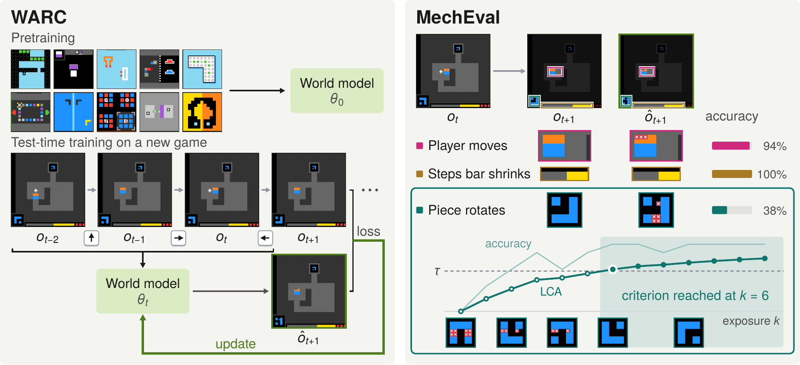

# How Many Exposures Does a World Model Need? Learning Mechanics in Unseen Games at Test Time

[](https://arxiv.org/abs/2611.12324)
[](https://huggingface.co/third-intelligence/WARC)
[](LICENSE)

Ku Onoda, Haruto Kawano, Shota Takashiro, Kohei Hayashi

> [!NOTE]
> This branch (`paper-v2`) holds the code of the current version of the paper (arXiv v2). The
> [`main`](https://github.com/third-intelligence/WARC/tree/main) branch is the version of our ARC Prize 2026 paper-track entry.

This repository holds WARC (the model, its pretraining and test-time training code, and the explorer of the
closed-loop experiments), MechEval (the annotator, the labels, the scorer, and the predictions of the paper), and the
weights of the fold models of the paper on [Hugging Face](https://huggingface.co/third-intelligence/WARC)
(`hf download third-intelligence/WARC --local-dir models`).



## Quick start: MechEval on a CPU

MechEval needs Python 3.12, `numpy` and the human recordings of the ARC Prize Foundation. The recordings are not
included; download them and set them up as in [data/README.md](data/README.md).

```bash
git clone -b paper-v2 https://github.com/third-intelligence/WARC.git && cd WARC
pip install numpy==2.5.3
python -m mecheval check-data --recordings data                 # the 279 recordings against their SHA-256
python -m mecheval reproduce --recordings data --workers 8      # the paper's values of WARC and frozen WARC
```

`reproduce` scores the paper's predictions in `mecheval/reference/` (WARC at test-time seed 0, and frozen WARC),
prints each value next to the paper's, and ends with `reproduced the paper`.

## Evaluating your world model on MechEval

Write a class that predicts the next frame and may learn from the true one:

```python
class MyModel:
    def __init__(self, game, **kwargs):                       # a new model for every recording
        ...
    def predict(self, history, action):                       # the next frame: a 64 x 64 array of colours 0 to 15
        ...
    def update(self, history, action, next_frame, valid):     # the true next frame; learn from it or not
        ...
```

Put `mymodule.py` in this directory or on `PYTHONPATH`. Then run it on the 279 recordings, score it next to WARC, and
print the summary table:

```bash
python -m mecheval run --model mymodule:MyModel --recordings data --out mecheval_out/predictions/mymodel
python -m mecheval score --recordings data --pred mymodel=mecheval_out/predictions/mymodel \
    --pred warc=mecheval/reference/warc --out mecheval_out/scores --workers 8
python -m mecheval report mecheval_out/scores --out mecheval_out/report
```

[mecheval/README.md](mecheval/README.md#evaluating-a-model) describes `history`, the actions, the protocol and the
measures. `annotate` labels new plays of the 20 games, such as an agent's
([mecheval/README.md](mecheval/README.md#annotating-your-own-plays)).

## Running WARC

WARC needs PyTorch 2.7.0 and the weights from Hugging Face:

```bash
python3.12 -m venv .venv && source .venv/bin/activate
pip install torch==2.7.0 torchvision==0.22.0 --index-url https://download.pytorch.org/whl/cu126
pip install -r requirements.txt
hf download third-intelligence/WARC --local-dir models    # the three fold models, the all-25 model and manifest.json
```

To run WARC with test-time training on MechEval (a GPU) and score it:

```bash
python -m mecheval run --model mecheval.examples.warc:WARC --arg arm=ttt --arg device=cuda \
    --recordings data --out mecheval_out/predictions/warc
python -m mecheval score --recordings data --pred warc=mecheval_out/predictions/warc \
    --out mecheval_out/scores_warc --workers 8
python -m mecheval report mecheval_out/scores_warc --out mecheval_out/report_warc
```

Test-time training on a GPU is not deterministic, so a new run differs slightly from the paper's predictions. Frozen
WARC runs on a CPU ([mecheval/README.md](mecheval/README.md#running-warc)). The agent of the closed-loop experiments and
the retraining of the fold models are in [docs/reproducibility.md](docs/reproducibility.md).

## Reproducing the paper

| What | Command | Needs |
|---|---|---|
| The MechEval values of WARC (test-time seed 0) and frozen WARC, from the included predictions | `python -m mecheval reproduce --recordings data --workers 8` | `numpy` |
| Label the 279 recordings again with the annotator; the result equals `mecheval/labels/` byte for byte | `python -m mecheval annotate --recordings data --out mecheval_out/labels --workers 8` | `pip install arcengine==0.9.3 scipy==1.18.1` |
| Run WARC on MechEval with the weights from Hugging Face, then score it | "Running WARC" above | PyTorch; a GPU for test-time training |
| Run the agent of the closed-loop experiments | [docs/reproducibility.md](docs/reproducibility.md#1-run-the-agent) | PyTorch, a GPU |
| Retrain the fold models | [docs/reproducibility.md](docs/reproducibility.md#2-retrain-the-weights) | six GPUs |

The code of the other models in the paper is not included.

## Documentation

| Document | Contents |
|---|---|
| [mecheval/README.md](mecheval/README.md) | MechEval: label plays of the 20 games, run and score a world model on the labelled recordings, and reproduce the paper's values. |
| [data/README.md](data/README.md) | The human recordings and how to set them up and check them. |
| [docs/reproducibility.md](docs/reproducibility.md) | Run the agent; retrain the fold models and the all-25 model; the pretraining and test-time training recipes; a CPU dry run. |
| [warc/README.md](warc/README.md) | The pretraining scripts. |
| [agent/README.md](agent/README.md) | The agent code: the model, test-time training, the explorer. |
| [docs/third_party.md](docs/third_party.md) | Third-party code in this repository and its licences. |

## Repository layout

```
agent/warc_model/                 the WARC model (model.py), test-time training (final_ttt.py), the agent's player
agent/VARC/                       backbone, data module, trainer, frame window, explorer, game wrapper and episode loop (our code built on VARC)
agent/play.py                     runs the agent on one game (the explorer, WARC and its update recipe)
agent/warc_agents/, warc_eval/    the training-free explorer, the downloader of the public games, and their runner
agent/vendor/graph_exploration/   the training-free explorer of Rudakov et al. (MIT)
warc/                             pretraining: train.py (fold models), train_all25.py
models/                           the weights, downloaded from Hugging Face: the three fold models, the all-25 model, and manifest.json with their SHA-256 and the fold split
data/                             where the human recordings go
mecheval/                         MechEval: annotator, labels, scorer, runner, reference predictions (needs no GPU)
docs/                             reproducibility, third-party notices, the figure above
```

## Citation

```bibtex
@misc{onoda2026exposures,
  title         = {How Many Exposures Does a World Model Need? Learning Mechanics in Unseen Games at Test Time},
  author        = {Ku Onoda and Haruto Kawano and Shota Takashiro and Kohei Hayashi},
  year          = {2026},
  eprint        = {2611.12324},
  archivePrefix = {arXiv},
  primaryClass  = {cs.LG},
  url           = {https://arxiv.org/abs/2611.12324},
}
```

## Acknowledgements

- The model follows [VARC](https://arxiv.org/abs/2511.14761) (Hu et al., 2025), a vision transformer with test-time
  training for ARC, extended here to action-conditioned next-frame prediction. The backbone, the training utilities,
  and the rotary embedding are adapted from the [VARC code](https://github.com/lillian039/VARC) (MIT).
- The explorer follows the graph-exploration agent of
  [Evgenii Rudakov](https://github.com/dolphin-in-a-coma/arc-agi-3-just-explore) (MIT), whose code is included as a
  training-free explorer (`agent/vendor/graph_exploration/`).
- The list of mechanics and the instrumented game programs of the MechEval annotator build on a concurrent study of
  the same games, credited once it is published.
- The games and the human recordings belong to the [ARC Prize Foundation](https://arcprize.org).

Every third-party file and its licence is listed in [docs/third_party.md](docs/third_party.md); the licence texts are
in [`incl_licenses/`](incl_licenses/).

## License

The code and the weights are released under [CC0 1.0](LICENSE). Third-party components keep their own licences; see
[docs/third_party.md](docs/third_party.md).
