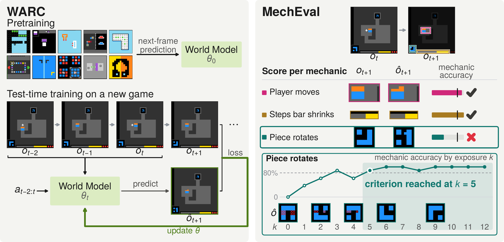

# How Many Exposures Does a World Model Need? Learning Unseen Game Mechanics at Test Time

[](https://huggingface.co/third-intelligence/WARC)
[](https://www.kaggle.com/code/onodaku/warc-arc3-notebook-v2?scriptVersionId=362286067)
[](LICENSE)

Ku Onoda, Haruto Kawano, Shota Takashiro, Kohei Hayashi

WARC (World model for ARC-AGI-3) is a 35M-parameter action-conditioned vision transformer. It
predicts the next frame of a game, cell by cell, from the last three frames and
the action, and it keeps learning while an agent plays: after every observed
transition it updates all of its parameters by gradient descent. Pretrained on
human recordings of other games, it learns to predict four in five mechanics
of an unseen game with at least 80% accuracy on the cells they change and keeps
that accuracy to the end of the recordings. This repository holds the model,
its pretraining and test-time training code, and the explorer of our ARC Prize
2026 entry. The weights are on Hugging Face.

- **Next-frame prediction at the cell level.** From the last three frames and
  the action, the model outputs a distribution over the 16 colours of every
  cell of the next frame. A learned vector marks the clicked cell.
- **Test-time training on every transition.** After each observed transition
  the model takes 20 gradient steps on the ten newest and twenty earlier
  transitions, and every parameter is updated.
- **An explorer that uses the predictions.** The explorer keeps a graph of the
  states it has visited and returns to states with untried actions, following
  Rudakov et al. in our own implementation. WARC predicts the outcome of
  every candidate action, and the explorer takes the action whose predicted
  frame differs most from the frames already seen, with a two-step look-ahead
  over the best 32 candidates.
- **Measured per mechanic.** The paper introduces MechEval, which reads the
  mechanics of 20 games from their programs and scores every prediction on the
  cells a mechanic changes, as a function of the model's exposures to that
  mechanic.



## Release plan

- [x] WARC: the model, the pretraining and test-time training code, the explorer, and the weights
- [ ] MechEval: the annotations and the scorer

## Documentation

| Document | Contents |
|---|---|
| [docs/reproducibility.md](docs/reproducibility.md) | Rerun the Kaggle submission; retrain the fold models and the all-25 model; the pretraining and test-time training recipes; a CPU dry run. |
| [warc/README.md](warc/README.md) | The pretraining scripts. |
| [data/README.md](data/README.md) | The pretraining recordings and how to check them. |
| [docs/third_party.md](docs/third_party.md) | Third-party code in this repository and its licences. |

## Installation

Python 3.12 and PyTorch 2.7.0.

```bash
git clone https://github.com/third-intelligence/WARC
cd WARC
python3.12 -m venv .venv && source .venv/bin/activate
pip install torch==2.7.0 torchvision==0.22.0 --index-url https://download.pytorch.org/whl/cu126
pip install -r requirements.txt
hf download third-intelligence/WARC --local-dir models    # the four checkpoints (pip install huggingface_hub)
```

## Quick start

Predict the next frame:

```python
import sys
import torch

sys.path[:0] = ["agent", "agent/VARC"]
from warc_model.model import build_from_checkpoint

device = torch.device("cuda")
model, meta = build_from_checkpoint("models/all25/checkpoint_best.pt", device=device)

# The last three frames, (1, 3, 64, 64) colours 0-15. Actions: 1-5 are the keys ACTION1-ACTION5,
# 6 is a click at column x and row y; x and y are -1 for a key.
frames = torch.randint(0, 16, (1, 3, 64, 64), device=device)     # replace with frames of a game
action, x, y = (torch.tensor(v, device=device) for v in ([6], [10], [20]))          # the action after the last frame
hist_action, hist_x, hist_y = (torch.tensor(v, device=device) for v in ([[1, 2]], [[-1, -1]], [[-1, -1]]))  # the two actions between the frames

with torch.no_grad():
    logits = model(frames[:, -1], torch.zeros(1, dtype=torch.long, device=device), action, x, y,
                   hist_obs=frames, hist_action_ids=hist_action, hist_action_xs=hist_x,
                   hist_action_ys=hist_y)["ffp_logits"]          # (1, 16, 64, 64)
next_frame = logits.argmax(1)[0]                                 # (64, 64) predicted colours
```

Predict and learn inside a game loop, with the recipe of the submission:

```python
from warc_model.final_ttt import FinalPredictor
from hist_window.src.history import HistoryWindow

predictor = FinalPredictor("models/all25/checkpoint_best.pt", game="ls20", arm="ttt", device="cuda", seed=0,
                           strict_split=False)   # the all-25 model was pretrained on every public game
window = HistoryWindow(n=3)
window.reset(first_frame)                                        # (64, 64) colours, the first frame of a level

candidates = [(1, -1, -1), (2, -1, -1), (6, 10, 20)]             # (action, x, y)
change_prob, predicted = predictor.predict(window, candidates)   # per candidate: (64, 64) change probability and predicted frame
predictor.observe(window, (1, -1, -1), next_frame)               # the observed transition: 20 gradient steps
window.push((1, -1, -1), next_frame)
```

`arm="frozen"` disables the updates. The fold models refuse the games they were
pretrained on; the all-25 model needs `strict_split=False`, because it was pretrained on every public game. The agent of the Kaggle
notebook wraps this predictor (`agent/warc_model/player.py`).

Run the agent on a game, with the explorer, the world model and the update
recipe of the notebook, against the environment files of the public games:

```bash
# once: download the 25 public games from the ARC Prize API into data/pub25/games
python -c "import sys; sys.path.insert(0, 'agent'); from warc_eval.prepare import prepare; prepare('data/pub25')"
python -B agent/play.py --game tr87 --ckpt models/fold2/checkpoint_best.pt \
    --environments-dir data/pub25/games --budget 1000 --seed 0 --out-dir runs/tr87_s0
```

`summary.json` and `steps.json` in the output directory record the levels
cleared, every action, and the updates. For the all-25 model, pass
`--no-strict-split` (see above). A game of 1,000 actions takes
minutes on a GPU; on a CPU each action takes a few minutes.

## Model summary

| | |
|---|---|
| Input | The last three 64x64 frames of 16 colours, the action after the last frame, and the two actions between the frames |
| Output | A distribution over the 16 colours of every cell of the next frame |
| Architecture | 2x2 patches, 10 pre-norm transformer blocks of width 512 with rotary position embeddings, modulated by the action through adaptive layer normalization; a learned vector added to the token of the clicked cell |
| Parameters | 35M |
| Pretraining | Next-frame cross-entropy on human recordings of the public games; Muon and AdamW, learning rate 3e-4, 30 epochs, global batch 516 |
| Test-time training | 20 gradient steps on the ten newest and twenty earlier transitions after every observed transition; all parameters are updated |
| Released weights | `fold1`, `fold2`, `fold3` (each pretrained on 16 or 17 games and evaluated on its 8 or 9 held-out games, used in the paper) and `all25` (pretrained on all 25 public games, used in the Kaggle submission); 146 MB each |

## Evaluation

MechEval scores a model on the cells a mechanic changes, before the model
learns from that transition, over the 69 recurring mechanics of 20 games. Every
model sees the same human recordings. The table lists the mechanic accuracy over all
exposures (All), the median exposures to criterion (EtC), and the fraction of
mechanics that do not reach the criterion (n.r.). A mechanic's EtC is the first
exposure from which its accuracy stays at or above 80% to its last exposure, or
its last exposure if it does not reach the criterion. WARC, WARC (scratch), and
DreamerV3 average three test-time seeds. The other rows do not update, so their
predictions are the same under every seed.

| Model | All (%) ↑ | EtC (exposures) ↓ | n.r. (%) ↓ |
|---|---:|---:|---:|
| Episodic retrieval | 32.9 | 109.0 | 76.8 |
| WARC (frozen): no updates | 18.4 | 114.0 | 85.5 |
| WARC (scratch): no pretraining | 35.0 | 105.0 | 51.2 |
| WARC (GRU): recurrent state, no updates | 24.0 | 87.0 | 84.1 |
| DreamerV3 | 25.9 | 114.0 | 90.8 |
| **WARC** | **69.1** | **74.0** | **18.8** |

The speed comes from pretraining and from a gradient update after each
transition, which can be low-rank. The recurrent state of WARC (GRU), which reads the same transitions,
does not replace the updates at this pretraining scale. What WARC learns carries
over to other recordings of the game, including moves it has not
seen. The paper reports the learning curves, the generalization tests, the
ablations, and the closed-loop comparison with the explorer fixed.

The Kaggle submission, the all-25 model inside the graph explorer, scored 0.20
on the public leaderboard of the Kaggle competition. Appendix A of the paper describes the
submission and how it differs from the evaluation protocol.

## Repository layout

```
agent/warc_model/                 the WARC model (model.py), test-time training (final_ttt.py), the agent's player
agent/VARC/                       backbone, data module, trainer, frame window, explorer, game wrapper and episode loop (our code built on VARC)
agent/play.py                     runs the agent on one game (the explorer, WARC and the update recipe of the notebook)
agent/warc_agents/, warc_eval/    the training-free explorer, the downloader of the public games, and their runner
agent/vendor/graph_exploration/   the training-free explorer of Rudakov et al. (MIT)
warc/                             pretraining: train.py (fold models), train_all25.py
models/                           weights (downloaded) and manifest.json with their SHA-256 and the fold split
data/                             where the pretraining recordings go
docs/                             reproducibility, third-party notices, figures
```

## Citation

```bibtex
@misc{warc2026,
  title  = {How Many Exposures Does a World Model Need? Learning Unseen Game Mechanics at Test Time},
  author = {Ku Onoda and Haruto Kawano and Shota Takashiro and Kohei Hayashi},
  year   = {2026},
  note   = {ARC Prize 2026 paper track},
  url    = {https://github.com/third-intelligence/WARC},
}
```

## Acknowledgements

- The model follows [VARC](https://arxiv.org/abs/2511.14761) (Hu et al., 2025), a
  vision transformer with test-time training for ARC, extended here to
  action-conditioned next-frame prediction. The backbone, the training
  utilities, and the rotary embedding are adapted from the
  [VARC code](https://github.com/lillian039/VARC) (MIT).
- The explorer follows the graph-exploration agent of
  [Evgenii Rudakov](https://github.com/dolphin-in-a-coma/arc-agi-3-just-explore)
  (MIT), whose code is included as a training-free explorer (`agent/vendor/graph_exploration/`).
- The games and the human recordings belong to the
  [ARC Prize Foundation](https://arcprize.org).

Every third-party file and its licence is listed in [docs/third_party.md](docs/third_party.md);
the licence texts are in [`incl_licenses/`](incl_licenses/).

## License

The code and the weights are released under
[CC0 1.0](LICENSE). Third-party components keep their own licences; see
[docs/third_party.md](docs/third_party.md).
